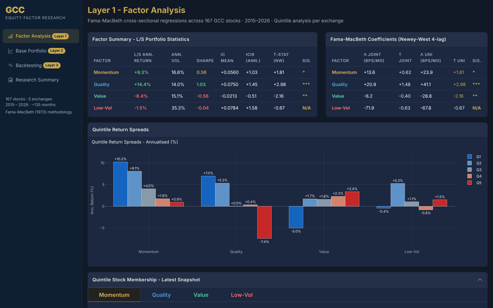
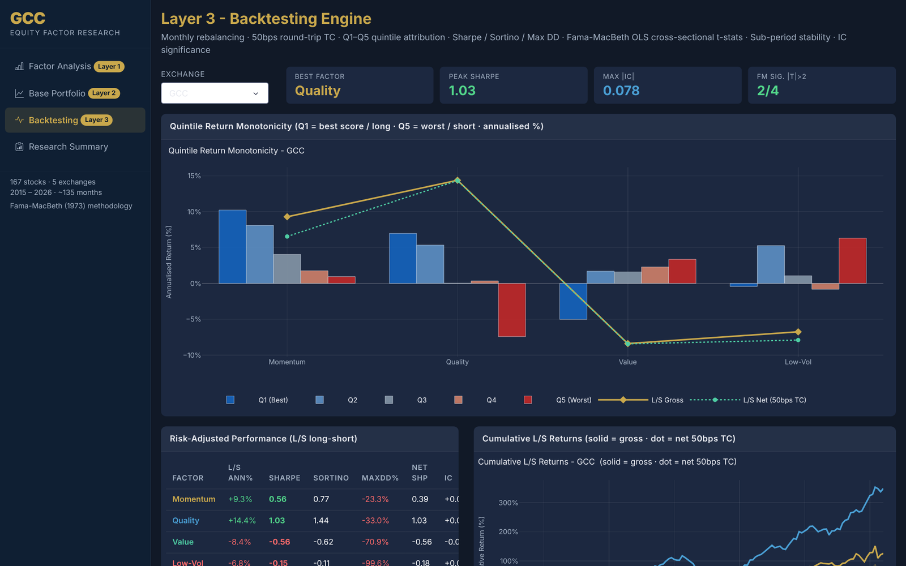
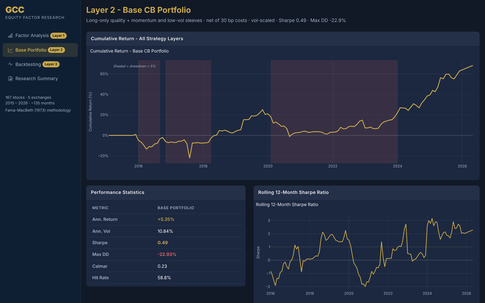
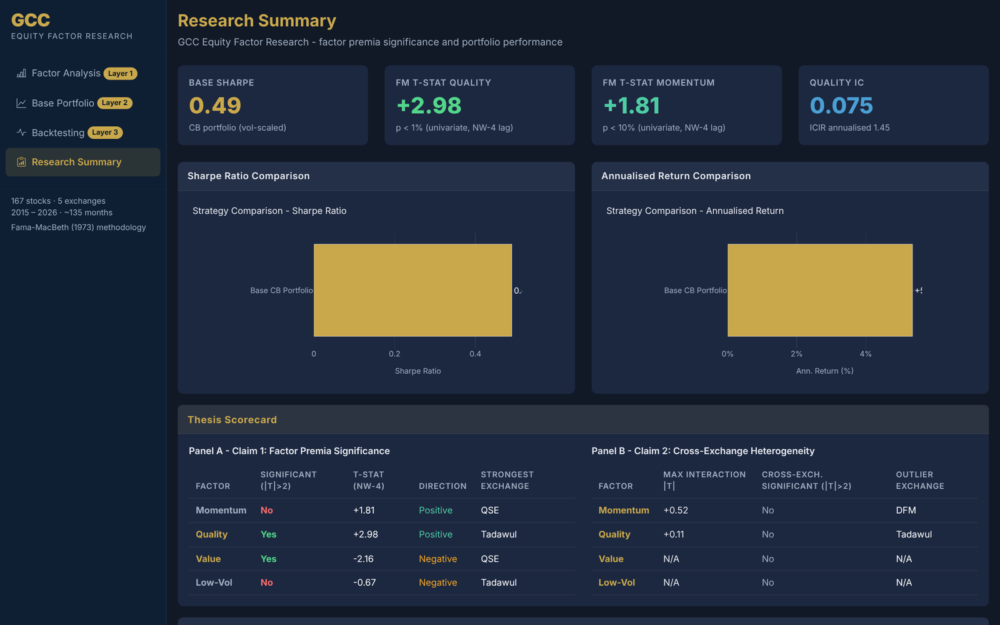

# GCC Equity Factor Research

[](../../actions/workflows/tests.yml)

Do the classic equity factors (value, momentum, quality and low volatility) earn a premium in Gulf stock markets, and do they behave differently across exchanges?

This project tests that on **167 stocks across five GCC exchanges** (Tadawul, ADX, DFM, QSE and Boursa Kuwait) using monthly data from **March 2015 to May 2026**. It uses long-short quintile portfolios, Fama-MacBeth cross-sectional regressions with Newey-West standard errors, and rank information coefficients. The results feed a two-sleeve multi-factor portfolio, and an interactive Dash dashboard presents everything.

## Results

**Factor premia, full GCC universe** (equal-weighted long-short quintile portfolios):

| Factor | L/S return (ann.) | Sharpe | Fama-MacBeth t (univariate) | IC t-stat | Verdict |
|---|---|---|---|---|---|
| Value | −8.4% | −0.56 | −2.16 ** | −1.70 | **Inverted.** Cheap stocks underperform. |
| Momentum | +9.3% | 0.56 | +1.81 * | +3.32 | Works. Price-based, so not affected by look-ahead. |
| Quality | +14.4% | 1.03 | +2.98 *** | +4.87 | Strongest signal, but an upper bound (see below). |
| Low volatility | −1.5% | −0.04 | −0.67 | +5.13 | Strong ranking signal that a long-short portfolio doesn't capture. |

<sub>* p<0.10, ** p<0.05, *** p<0.01. Newey-West t-statistics with 4 lags. 124–135 months.</sub>

**Multi-factor portfolio:** Sleeve A holds the top 20 stocks by combined quality and momentum, IC-weighted, scaled to 10% volatility. Sleeve B holds the 20 lowest-volatility stocks, scaled to 8% volatility. Net of 30 bp round-trip costs and with a drawdown circuit breaker, it earned **5.4% a year at 10.8% volatility (Sharpe 0.49)**, with a maximum drawdown of −22.9%.

### Main findings

1. **Value is inverted in the Gulf, and the result is statistically significant.** It holds on every exchange where it can be measured. Oil-linked "cheap" stocks stayed cheap, and limited foreign institutional ownership slows the correction of mispricing.
2. **Momentum is real and clean.** Quintile returns fall in perfect order from Q1 to Q5, and the signal has strengthened since 2024. Dubai shows the most orderly momentum of any exchange.
3. **Quality has the strongest univariate evidence, but it should be discounted.** The fundamentals are a 2025 snapshot applied back to 2015, which introduces look-ahead bias. A realistic out-of-sample Sharpe is probably 0.4–0.6, not 1.03. Quality also loses significance in the joint regression with all four factors (t = 1.48).
4. **Low volatility ranks stocks well** (ICIR 1.58), but the long-short spread is negative even after filtering illiquid names from the short book. It looks like a long-only signal.

The full write-up is in [`docs/research_summary.md`](docs/research_summary.md). It covers exchange-level results, sub-periods (pre-COVID, COVID, post-COVID, 2024–26) and Kuwait's MSCI upgrade as a natural experiment.

## Dashboard

An interactive Plotly Dash app presents every layer of the research. It runs from the derived outputs in `data/`.



| | |
|---|---|
|  |  |
| **Backtesting.** Quintile monotonicity, net-of-cost L/S returns and IC by exchange | **Portfolio.** Cumulative return, drawdowns and rolling 12-month Sharpe |



## Limitations

- **Look-ahead bias in fundamentals.** Value and quality use a single December 2025 snapshot from Yahoo Finance, not point-in-time history. Treat both results as upper bounds.
- **Survivorship bias.** The universe is stocks listed in late 2025. Delisted names are missing, which tends to inflate factor spreads.
- **Shorting.** Stock borrowing is limited outside Tadawul. The long-short portfolios test whether a signal is real; they are not a trading plan.
- **The options overlay is simulated.** The docs also test a covered-call overlay on Tadawul single-stock options (Sharpe 1.49–1.84). Those options only started trading in November 2023, so the overlay is priced off a synthetic implied-volatility surface. It is a hypothesis, not a backtest.

## Run it

```bash
pip install -r requirements.txt
python app.py              # dashboard at http://127.0.0.1:8050
pytest -q tests            # checks the headline numbers against the output files
```

To host the dashboard, `render.yaml` deploys it as a free web service on [Render](https://render.com): choose **New → Blueprint** and select this repository.

The dashboard runs from the derived outputs in `data/`. Raw prices and fundamentals aren't redistributed. [`data/README.md`](data/README.md) explains how to download them and rebuild every layer.

## How it's built

| Layer | Code | What it does |
|---|---|---|
| 1. Data | `Layer_1/` | Downloads daily prices (yfinance, with TradingView for ADX/DFM gaps), applies liquidity filters and builds monthly log returns. Kuwait is split around its June 2020 MSCI upgrade. |
| 2. Factors | `Layer_2/factor_construction.py` | Builds value (inverse P/B and EV/EBITDA), momentum (12-1 month), quality (ROE 50%, earnings stability 30%, operating margin 20%) and low-vol (trailing 252-day volatility) scores. Winsorises at the 1st/99th percentile, z-scores across the GCC cross-section and forms quintile portfolios. |
| 3a. Significance | `Layer_3_analysis/fama_macbeth_3a.py` | Runs monthly cross-sectional regressions with Newey-West t-statistics, univariate and joint. |
| 3b. Attribution | `Layer_3_analysis/backtest.py`, `portfolio.py` | Calculates IC decay, turnover, sub-period splits and drawdowns, then builds the two-sleeve portfolio with costs, vol targeting and a circuit breaker. |
| 3c. Overlay | `Layer_3_analysis/layer3c_vol_surface.py` | Builds the synthetic vol surface and the simulated covered-call overlay. |
| Dashboard | `app.py`, `pages/`, `utils/` | Plotly Dash app covering factor analysis, the portfolio, backtests and a research summary. |

Tests in `tests/` recompute the headline Sharpe ratios from the shipped return series and check the Newey-West estimator. They also confirm that every dashboard page builds. GitHub Actions runs them on every push.

---

Research by [Sudipt Jethro Das](https://github.com/SudiptJethro). This is independent research, not investment advice.
